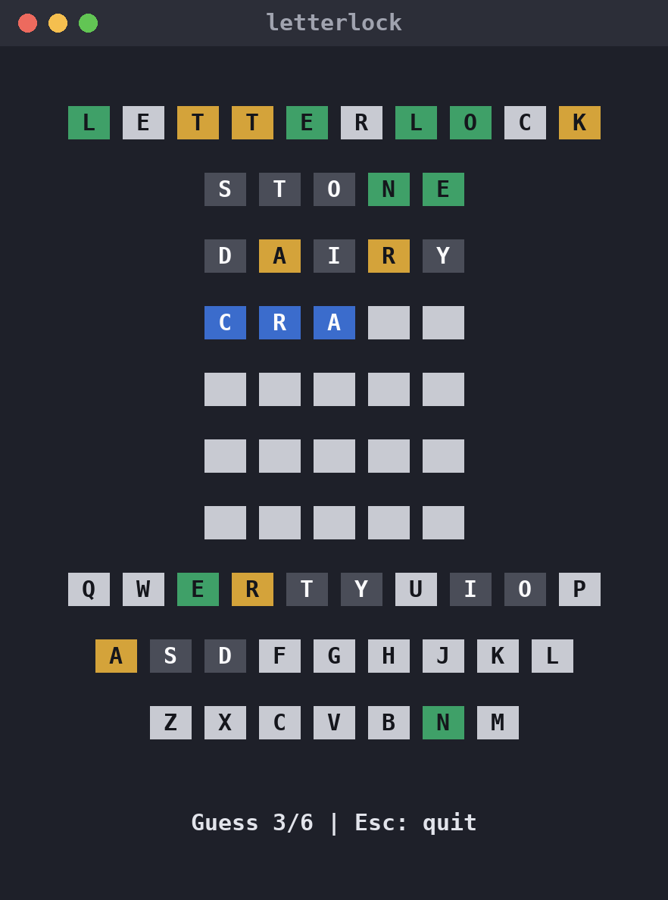
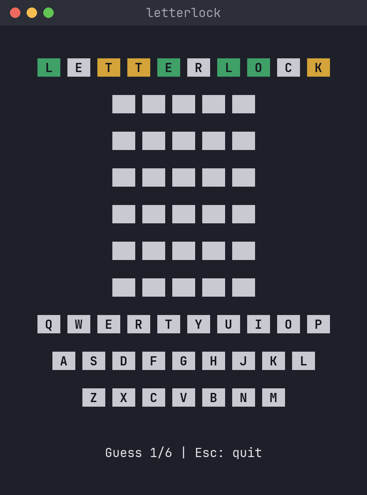
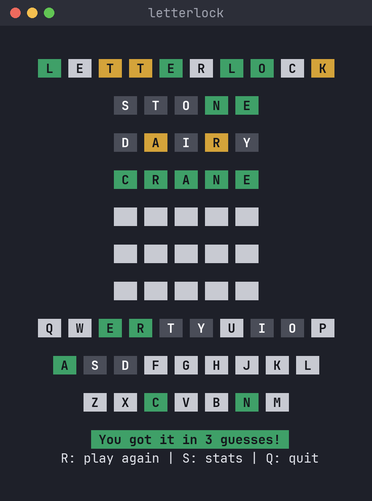
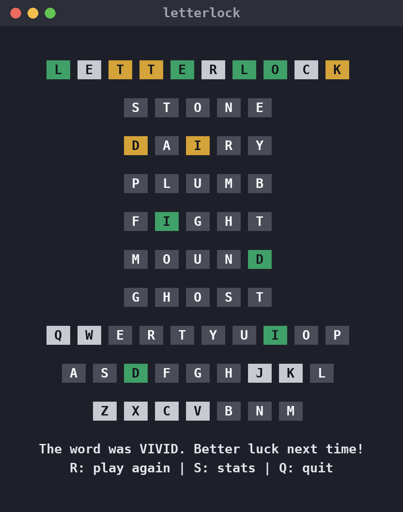
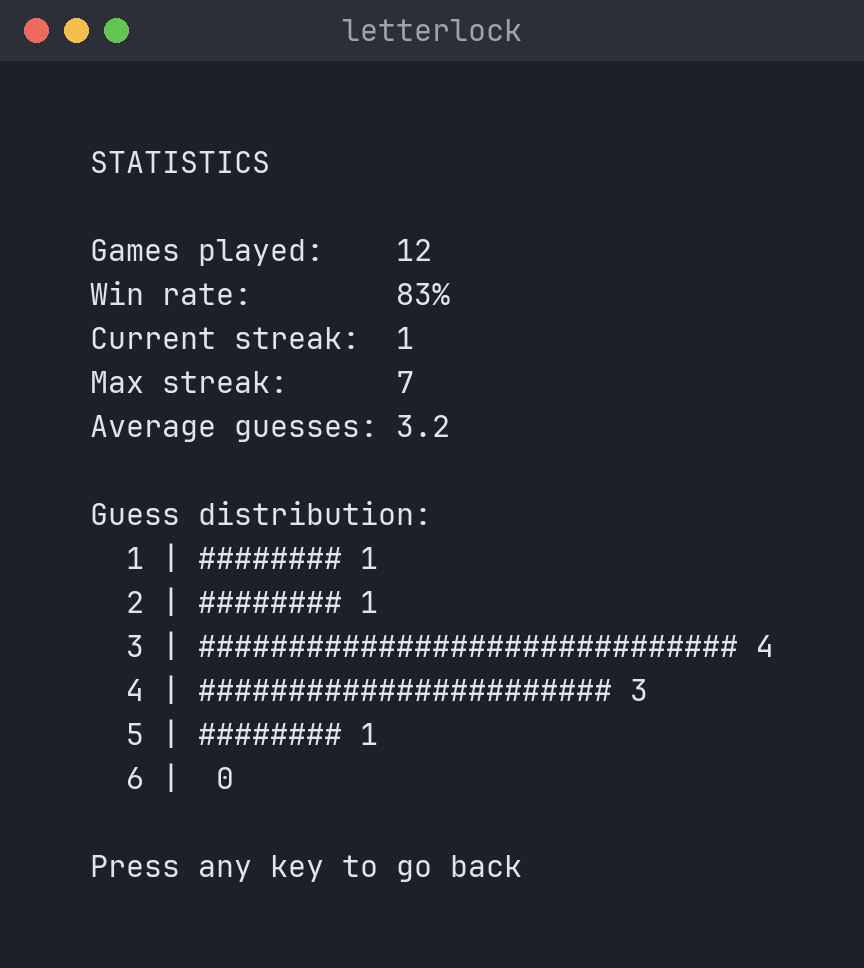
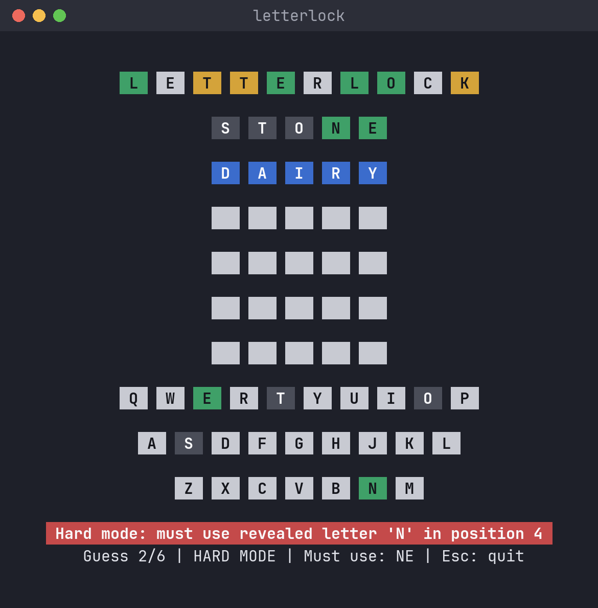
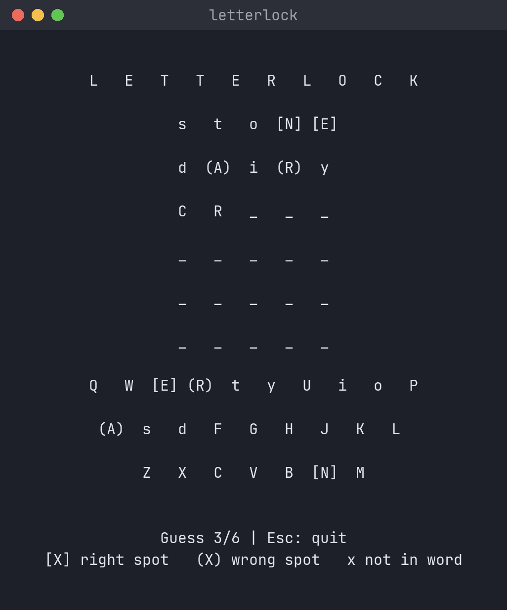
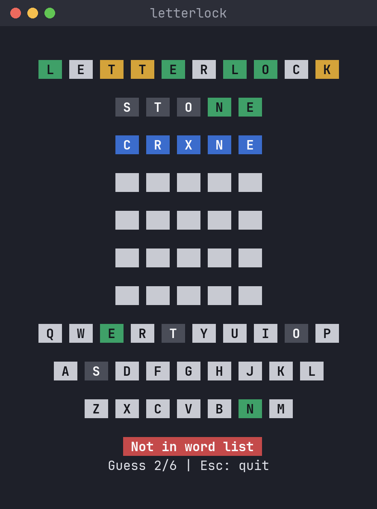

# letterlock

[](https://crates.io/crates/letterlock)
[](https://github.com/pravin/letterlock/actions/workflows/ci.yml)
[](https://github.com/pravin/letterlock/releases/latest)
[](LICENSE)

_Formerly `cwordle`._

**Crack the five-letter code in six guesses, right in your terminal.**

letterlock is a free, open-source word-guessing game. After each guess the tiles show which
letters are in the right spot, which are in the word but somewhere else, and which aren't in
the word at all. One small binary, no account, no ads, works offline.



## Features

- Runs natively on **Linux, macOS and Windows** (x86_64 and ARM64), with no libraries to install
- **Hard mode**: every hint you uncover has to be used in later guesses
- **Statistics**: win rate, streaks and a guess distribution, saved between sessions
- **Accessible**: a no-colour mode that marks tiles with symbols instead of colours
- Adapts to your terminal size and redraws when you resize the window

## Install

**macOS / Linux** with [Homebrew](https://brew.sh):

```sh
brew install pravin/tap/letterlock
```

**Windows** with [Scoop](https://scoop.sh):

```powershell
scoop bucket add pravin https://github.com/pravin/scoop-bucket
scoop install letterlock
```

**Any platform** with [Rust](https://rustup.rs):

```sh
cargo install letterlock
```

### Download a binary

Grab the archive for your system from the
[latest release](https://github.com/pravin/letterlock/releases/latest), extract it, and run
`letterlock` (`letterlock.exe` on Windows).

| System | File |
| --- | --- |
| Windows (most PCs) | `letterlock-<version>-x86_64-pc-windows-msvc.zip` |
| Windows on ARM | `letterlock-<version>-aarch64-pc-windows-msvc.zip` |
| macOS (Apple silicon) | `letterlock-<version>-aarch64-apple-darwin.tar.gz` |
| macOS (Intel) | `letterlock-<version>-x86_64-apple-darwin.tar.gz` |
| Linux (x86_64) | `letterlock-<version>-x86_64-unknown-linux-musl.tar.gz` |
| Linux (ARM64, e.g. Raspberry Pi) | `letterlock-<version>-aarch64-unknown-linux-musl.tar.gz` |

Each archive has a matching `.sha256` checksum file.

> **First run on macOS:** the binaries aren't signed yet, so if you downloaded with a browser,
> macOS may refuse to open the file. Run `xattr -d com.apple.quarantine letterlock` once.
>
> **First run on Windows:** SmartScreen may warn about an unrecognised app. Choose
> **More info → Run anyway**.

## How to play

```sh
letterlock              # new game
letterlock --hard-mode  # revealed hints must be used in later guesses
letterlock --stats      # print your statistics
letterlock --help       # all options
```

Type a five-letter word and press **Enter**. Each tile then changes colour:

- **Green**: right letter, right spot
- **Yellow**: the letter is in the word, but in a different spot
- **Dark grey**: the letter isn't in the word

The on-screen keyboard keeps track of every letter you've tried.

| Key | Action |
| --- | --- |
| `a`–`z` | Type a letter |
| `Backspace` | Delete a letter |
| `Enter` | Submit guess |
| `Esc` / `Ctrl+C` | Quit |

After a game: `R` to play again, `S` for statistics, `Q` to quit.

**Hard mode:** letters in the right spot must stay there, and letters found in the wrong spot
must appear in every later guess.

**No colour:** run with `--no-color` or set `NO_COLOR=1`. Tiles are then marked `[X]` (right
spot), `(X)` (wrong spot) and lowercase `x` (not in the word).

**Words:** the answer is always a common English word (about 1,700 of them), so you won't be
asked to find something obscure. Around 4,600 words are accepted as guesses.

Statistics are saved to:

- Linux: `~/.local/share/letterlock/stats.json` (respects `$XDG_DATA_HOME`)
- macOS: `~/Library/Application Support/letterlock/stats.json`
- Windows: `%APPDATA%\letterlock\stats.json`

## Screenshots

| | |
| :---: | :---: |
|  |  |
| Start screen | Solved in three guesses |
|  |  |
| Out of guesses | Statistics |
|  |  |
| Hard mode rejecting a guess | No-colour mode |
|  | |
| Word not in the list | |

## Development

```sh
cargo test
cargo run -- --word crane   # play with a fixed answer
```

CI runs formatting, lint and tests on Linux, macOS and Windows for every push and pull request.

### Word lists

- `src/word-list.txt`: every word accepted as a guess
- `src/answers.txt`: the words an answer can be picked from

`answers.txt` is generated from `word-list.txt` by keeping common words (by frequency in the
[`wordfreq`](https://pypi.org/project/wordfreq/) package), leaving out plurals, past tenses and a
curated exclusion list. After editing either file, regenerate it:

```sh
pip install wordfreq
python src/scripts/build-answers.py
```

### Releasing

1. Bump `version` in `Cargo.toml`, run `cargo build` to update `Cargo.lock`, and commit.
2. Tag and push, e.g. `git tag v0.3.0 && git push origin v0.3.0`.
3. The [Release workflow](.github/workflows/release.yml) builds all six binaries and publishes a
   GitHub release with checksums.
4. Publish to crates.io: `cargo publish`.
5. Update the package managers with the new version and the SHA-256 values from the release's
   `.sha256` files:
   - Homebrew: `Formula/letterlock.rb` in [pravin/homebrew-tap](https://github.com/pravin/homebrew-tap)
   - Scoop: `bucket/letterlock.json` in [pravin/scoop-bucket](https://github.com/pravin/scoop-bucket)

To test the builds without publishing, run the Release workflow manually from the Actions tab.
The binaries appear as downloadable artifacts on the run.

## License

GPL-3.0-or-later. See [LICENSE](LICENSE).
